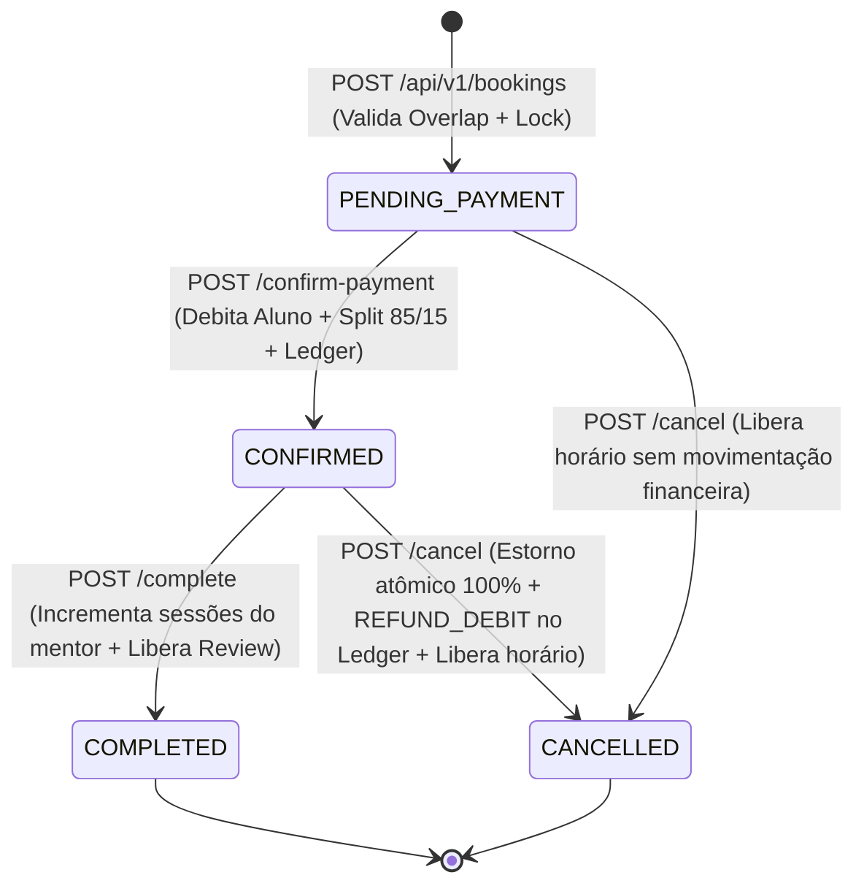
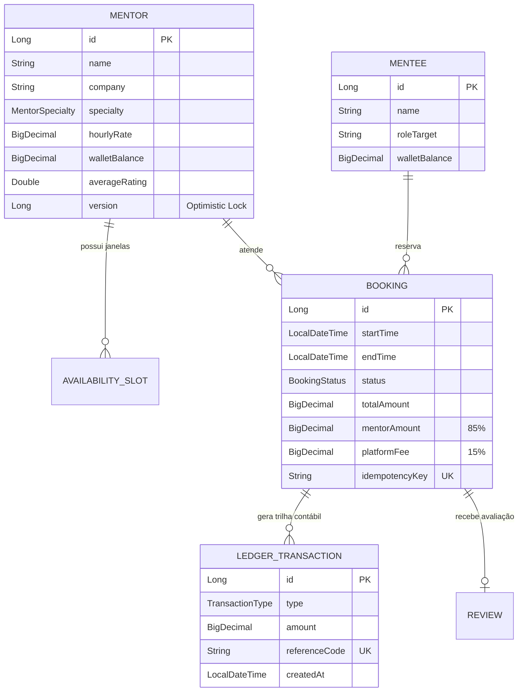

# MentorFlow API — Marketplace & Motor de Agendamento de Mentorias Tech


**MentorFlow** é uma API RESTful e plataforma de agendamento de mentorias técnicas desenvolvida com **Java 21** e **Spring Boot 3**, projetada para demonstrar soluções reais de **Engenharia de Software Backend**: controle de concorrência contra *Double-Booking*, idempotência, máquina de estados transacional, cálculo de *split* de pagamentos (85% / 15%) e trilha contábil imutável (*Financial Ledger*).

---

## 🎯 Por que este projeto vai além de um CRUD básico?

Em entrevistas técnicas para vagas de **Desenvolvedor Backend Java (Estágio / Júnior)**, recrutadores e *Tech Leads* avaliam se o candidato compreende problemas reais de produção. Este projeto resolve 5 desafios clássicos de engenharia:

1. **Prevenção de Concorrência e *Double-Booking* (`PESSIMISTIC_WRITE` + Overlap Detection):**
   - Ao agendar um horário, a transação adquire um *lock pessimista de escrita* (`@Lock(LockModeType.PESSIMISTIC_WRITE)`) no registro do Mentor antes de validar a interseção de horários (`startTime < reqEnd AND endTime > reqStart`).
   - Se duas requisições tentarem reservar o mesmo horário simultaneamente, o banco serializa a verificação e rejeita a segunda tentativa com **HTTP 409 Conflict**.
2. **Motor Financeiro de Split (85% / 15%) sem Perda de Centavos (`BigDecimal`):**
   - Toda operação monetária utiliza `BigDecimal` com arredondamento bancário `RoundingMode.HALF_UP`.
   - Na confirmação do pagamento, o sistema debita a carteira do mentorado, credita **85%** na carteira do mentor, retém **15%** de *take-rate* da plataforma e grava 3 registros imutáveis no **Ledger Contábil**.
3. **Estorno Reverso Atômico (`@Transactional`):**
   - Caso uma mentoria já paga (`CONFIRMED`) seja cancelada, o sistema reverte o *split* atomicamente, devolve 100% do saldo ao mentorado, registra um lançamento `REFUND_DEBIT` no Ledger e **libera imediatamente a janela de horário** na agenda do mentor.
4. **Idempotência de Requisições (`idempotencyKey`):**
   - Evita reservas duplicadas caso o cliente sofra *timeout* e reenvie a mesma requisição `POST /api/v1/bookings`.
5. **Prevenção do Problema de N+1 Queries & Padrão RFC 7807 (`ProblemDetail`):**
   - `spring.jpa.open-in-view=false` configurado por padrão, utilizando queries JPQL com `JOIN FETCH`.
   - Tratamento global de erros (`@RestControllerAdvice`) padronizado na especificação **RFC 7807 (Problem Details for HTTP APIs)**.

---

## 🔄 Máquina de Estados do Agendamento (Booking State Machine)



---

## 🗄️ Modelo de Dados (Entidade-Relacionamento)



---

## 🚀 Como Executar o Projeto

### Opção 1: Execução Rápida Zero-Config (Banco H2 em Memória + Dados Pré-Populados)

Não é necessário instalar banco de dados externo. O projeto já inclui o **Maven Wrapper** e um `DataSeederConfig` que popula mentores, alunos, saldos, agendamentos e transações ao iniciar:

```powershell
# No Windows PowerShell / CMD:
.\mvnw.cmd spring-boot:run

# No Linux / macOS:
./mvnw spring-boot:run
```

Acesse imediatamente no navegador:
- 🖥️ **Dashboard Interativo & Laboratório de Engenharia:** [http://localhost:8080](http://localhost:8080)
- 📄 **Documentação Interativa Swagger UI (OpenAPI 3):** [http://localhost:8080/swagger-ui.html](http://localhost:8080/swagger-ui.html)
- 🩺 **Spring Boot Actuator (Healthcheck):** [http://localhost:8080/actuator/health](http://localhost:8080/actuator/health)
- 🗄️ **Console do Banco H2:** [http://localhost:8080/h2-console](http://localhost:8080/h2-console) (`JDBC URL`: `jdbc:h2:mem:mentorflowdb`)

### Opção 2: Com Docker Compose + PostgreSQL 16

```bash
docker compose up --build
```

---

## 🧪 Executando a Suíte de Testes Automatizados (JUnit 5 + MockMvc)

O projeto conta com testes de integração de ponta a ponta validando filtros, cálculo de split 85/15, idempotência, bloqueio de conflito de horário (`HTTP 409`), máquina de estados e estorno com liberação de agenda:

```powershell
.\mvnw.cmd test
```

---

## 📡 Principais Endpoints da API REST

| Método | Endpoint | Descrição |
| :--- | :--- | :--- |
| `GET` | `/api/v1/mentors` | Lista mentores (aceita filtro `?specialty=BACKEND_JAVA`) |
| `POST` | `/api/v1/mentors` | Cadastra novo mentor com validação Bean Validation |
| `POST` | `/api/v1/mentors/{id}/availability` | Adiciona janela semanal de atendimento |
| `GET` | `/api/v1/mentees` | Lista mentorados e saldos de carteira |
| `POST` | `/api/v1/bookings` | Cria agendamento com detecção de conflito e idempotência |
| `POST` | `/api/v1/bookings/{id}/confirm-payment` | Executa pagamento atômico, split 85/15 e registro no Ledger |
| `POST` | `/api/v1/bookings/{id}/complete` | Conclui sessão de mentoria |
| `POST` | `/api/v1/bookings/{id}/cancel` | Cancela reserva, realiza estorno e libera horário |
| `POST` | `/api/v1/reviews` | Avalia mentoria concluída e recalcula média do mentor |
| `GET` | `/api/v1/dashboard/metrics` | Retorna GMV, receita da plataforma e extrato do Ledger |

---

## 💡 Guia para Entrevista Técnica (Como apresentar este projeto)

Durante entrevistas técnicas, destaque estes pontos:
1. **"Como você evitou que dois alunos reservassem o mesmo horário ao mesmo tempo?"**
   - *"Usei `@Lock(LockModeType.PESSIMISTIC_WRITE)` na busca do Mentor dentro da transação de criação do agendamento, combinado com a fórmula matemática de interseção de intervalos (`startTime < novoFim AND endTime > novoInicio`). Assim, duas requisições concorrentes para o mesmo mentor são serializadas no banco de dados e a segunda recebe `409 Conflict`."*
2. **"Como você lidou com valores monetários e divisão de pagamentos?"**
   - *"Nunca usei `double` ou `float` para dinheiro. Usei `BigDecimal` com escala 2 e `RoundingMode.HALF_UP`. Além disso, calculei a taxa da plataforma (15%) e obtive o valor do mentor por subtração (`totalAmount.subtract(platformFee)`), garantindo que a soma das partes seja 100% exata aos centavos, registrando tudo em uma tabela imutável `ledger_transactions`."*
3. **"Como você evitou o problema de N+1 Queries no Hibernate?"**
   - *"Desativei o anti-pattern `spring.jpa.open-in-view=false` e criei queries JPQL explícitas com `JOIN FETCH b.mentor JOIN FETCH b.mentee` no `BookingRepository`, buscando tudo em um único `SELECT`."*
