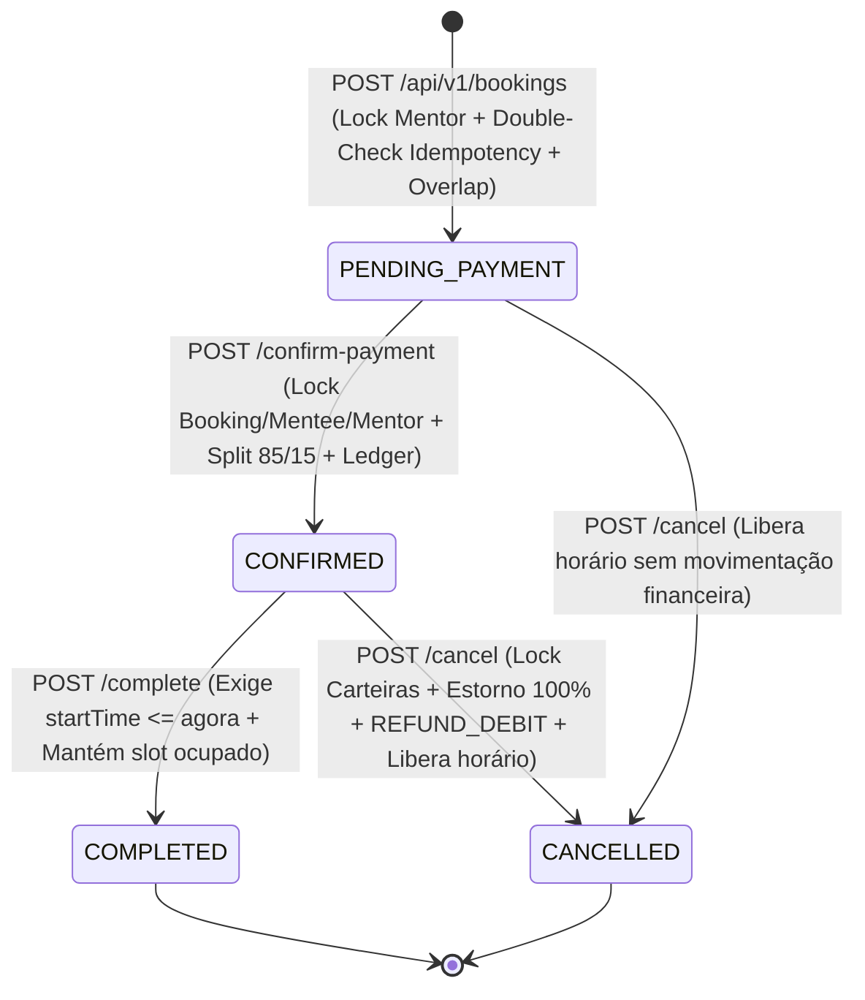
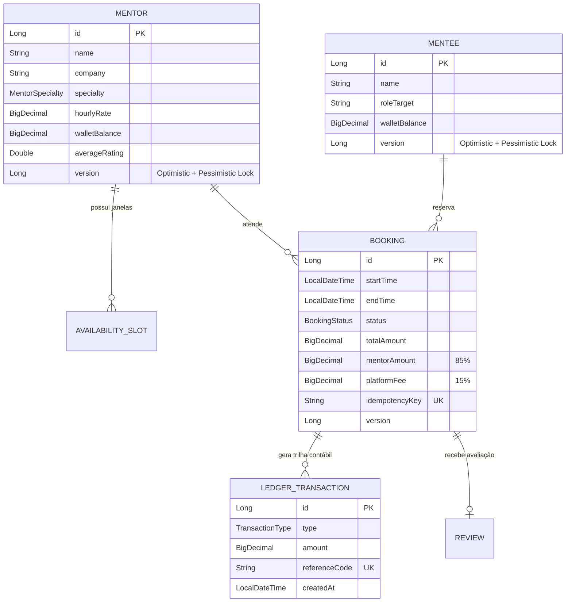

# MentorFlow API — Marketplace & Motor de Agendamento de Mentorias Tech


**MentorFlow** é uma API RESTful e plataforma de agendamento de mentorias técnicas desenvolvida com **Java 21** e **Spring Boot 3**, projetada para demonstrar e comprovar em testes automatizados soluções reais de **Engenharia de Software Backend**: controle de concorrência contra *Double-Booking* e *Lost Update*, idempotência sob requisições simultâneas, máquina de estados temporal, cálculo de *split* de pagamentos (85% / 15%) sem erro de arredondamento intermediário e trilha contábil imutável (*Financial Ledger*).

---

## 🔬 Engenharia de Confiabilidade: Cenários de Falha, Causas e Testes que Comprovam

Cada garantia arquitetural deste projeto foi modelada a partir de cenários reais de concorrência e precisão financeira, acompanhada de um **teste automatizado dedicado** em [`MentorFlowApplicationTests.java`](src/test/java/com/portfolio/mentorflow/MentorFlowApplicationTests.java) que tenta quebrar a invariante:

### 1. Concorrência na Carteira do Aluno (*Lost Update* em Pagamentos Simultâneos)
* **Cenário:** O mesmo mentorado dispara simultaneamente a confirmação de pagamento (`confirmPayment`) de duas mentorias distintas para **mentores diferentes**.
* **Falha se mal implementado:** Apenas `@Transactional` (em nível `READ COMMITTED`) ou lock apenas no `Mentor` não impede que as duas transações leiam o mesmo `walletBalance` do `Mentee`, validem o saldo em paralelo e sobrescrevam o `UPDATE` uma da outra (*Lost Update* / *Write Skew*).
* **Causa Raiz:** Ausência de serialização na linha da entidade pagadora (`Mentee`) durante a leitura-validação-débito.
* **Solução Aplicada:** Lock pessimista explícito (`@Lock(LockModeType.PESSIMISTIC_WRITE)` -> `SELECT ... FOR UPDATE`) no `Booking`, no `Mentee` (`MenteeRepository.findByIdWithLock`) e no `Mentor`, além de `@Version` na entidade `Mentee`.
* **Teste que Comprova:** `shouldPreventLostUpdateWhenSameMenteePaysTwoDifferentMentorsConcurrently()` — dispara threads simultâneas com `CountDownLatch` validando tanto o bloqueio por saldo insuficiente (`200` + `422`) quanto a soma exata de dois débitos concorrentes com saldo suficiente (`R$ 500 - R$ 180 - R$ 190 = R$ 130,00`).

### 2. Precisão Monetária em Minutos Fracionados (`BigDecimal`)
* **Cenário:** Sessão de **31 minutos** com um mentor cujo valor/hora é **R$ 1.500,00**.
* **Falha se mal implementado:** Se o código dividir `31 / 60` primeiro e arredondar para 4 casas decimais (`0,5167` horas) antes de multiplicar por `1500,00`, o resultado será **R$ 775,05** em vez do valor exato **R$ 775,00** ($\frac{1500 \times 31}{60} = 775$).
* **Causa Raiz:** Arredondamento prematuro na divisão intermediária de tempo antes da multiplicação pela tarifa horária.
* **Solução Aplicada:** Multiplicação antes da divisão com arredondamento apenas no resultado monetário final:
  `mentor.getHourlyRate().multiply(BigDecimal.valueOf(durationMinutes)).divide(BigDecimal.valueOf(60), 2, RoundingMode.HALF_UP)`.
* **Teste que Comprova:** `shouldCalculateExactFractionalMinutesWithoutPrematureRounding()` — valida que 31 min a R$ 1.500/h resulta exatamente em `totalAmount = 775.00`, `platformFee = 116.25` (15%) e `mentorAmount = 658.75` (85%).

### 3. Brecha de *Double-Booking* na Máquina de Estados (`COMPLETED` e Sessões Futuras)
* **Cenário:** Concluir prematuramente uma sessão futura ou tentar criar um novo agendamento sobrepondo o horário de uma sessão já marcada como `COMPLETED`.
* **Falha se mal implementado:** Se `completeBooking` não validar o relógio e a query de *overlap* filtrar apenas `PENDING_PAYMENT` e `CONFIRMED`, concluir uma reserva libera indevidamente o intervalo para uma segunda reserva no mesmo horário.
* **Causa Raiz:** Exclusão do estado `COMPLETED` na lista de status ocupados e falta de invariante temporal na transição `CONFIRMED -> COMPLETED`.
* **Solução Aplicada:** Inclusão de `COMPLETED` em `OCCUPIED_STATUSES` (`PENDING_PAYMENT`, `CONFIRMED`, `COMPLETED` — somente `CANCELLED` libera agenda) e bloqueio de conclusão de sessões futuras (`LocalDateTime.now().isBefore(booking.getStartTime())` -> `422 PREMATURE_SESSION_COMPLETION`).
* **Teste que Comprova:** `shouldRejectPrematureCompletionOfFutureSessionAndKeepCompletedSlotOccupied()`.

### 4. Condição de Corrida na Idempotência (`idempotencyKey`)
* **Cenário:** Duas ou mais requisições idênticas (mesma `idempotencyKey`, ex: *retry* de rede simultâneo) chegam no mesmo milissegundo.
* **Falha se mal implementado:** Se `findByIdempotencyKey` for consultado apenas *antes* do lock pessimista no mentor, ambas as threads passam pela verificação inicial como `empty`. A primeira cria a reserva e a segunda, ao adquirir o lock em seguida, bate na verificação de conflito de horário e recebe **`409 Conflict`** em vez de receber a mesma reserva idempotente.
* **Causa Raiz:** Falta de revalidação (*Double-Checked Locking*) da chave de idempotência após a aquisição do lock de exclusão mútua.
* **Solução Aplicada:** Revalidação de `bookingRepository.findByIdempotencyKey(normalizedKey)` imediatamente após `mentorRepository.findByIdWithLock(mentorId)`.
* **Teste que Comprova:** `shouldGuaranteeConcurrentIdempotencyWhenSimultaneousRequestsShareSameKey()` — dispara **8 threads simultâneas** com a mesma chave e comprova que todas as 8 recebem `201 Created` com o **mesmo `booking.id`**.

### 5. Auditoria Contábil de Pagamento e Estorno (`LedgerTransaction`)
* **Cenário:** Ciclo completo de captura de pagamento com *split* (85%/15%) seguido de cancelamento com estorno reverso.
* **Solução Aplicada:** Reversão atômica sob lock pessimista nas carteiras de `Mentee` e `Mentor` e gravação de lançamento `REFUND_DEBIT` no Ledger imutável.
* **Teste que Comprova:** `shouldAuditWalletBalancesAndLedgerEntriesAfterPaymentAndRefund()` — confere centavo a centavo os saldos iniciais, pós-pagamento e pós-estorno de ambas as carteiras, além dos 4 lançamentos contábeis gerados (`PAYMENT_CAPTURED`, `MENTOR_SPLIT_CREDIT`, `PLATFORM_FEE_CREDIT` e `REFUND_DEBIT`).

---

## 🔄 Máquina de Estados do Agendamento (Booking State Machine)



---

## 🗄️ Modelo de Dados (Entidade-Relacionamento)



---

## 🚀 Como Executar o Projeto

### Opção 1: Execução Local Rápida
```powershell
# No Windows PowerShell / CMD:
.\mvnw.cmd spring-boot:run

# No Linux / macOS:
./mvnw spring-boot:run
```

Acesse no navegador:
- 🖥️ **Dashboard Interativo & Laboratório de Engenharia:** [http://localhost:8080](http://localhost:8080)
- 📄 **Documentação Interativa Swagger UI (OpenAPI 3):** [http://localhost:8080/swagger-ui.html](http://localhost:8080/swagger-ui.html)
- 🩺 **Spring Boot Actuator (Healthcheck):** [http://localhost:8080/actuator/health](http://localhost:8080/actuator/health)

### Opção 2: Com Docker Compose + PostgreSQL 16 Real
```bash
docker compose up --build
```

---

## 🧪 Executando a Suíte de Testes (Concorrência Multi-Thread & Integração)

A suíte executa testes concorrentes com `ExecutorService` e `CountDownLatch` validando *locks* pessimistas, idempotência simultânea, precisão de centavos em minutos fracionados e reconciliação de carteiras/ledger (executada também contra **PostgreSQL 16 real** no pipeline do GitHub Actions):

```powershell
.\mvnw.cmd test
```
